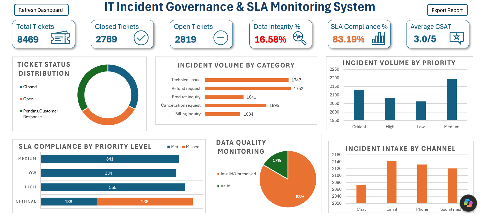
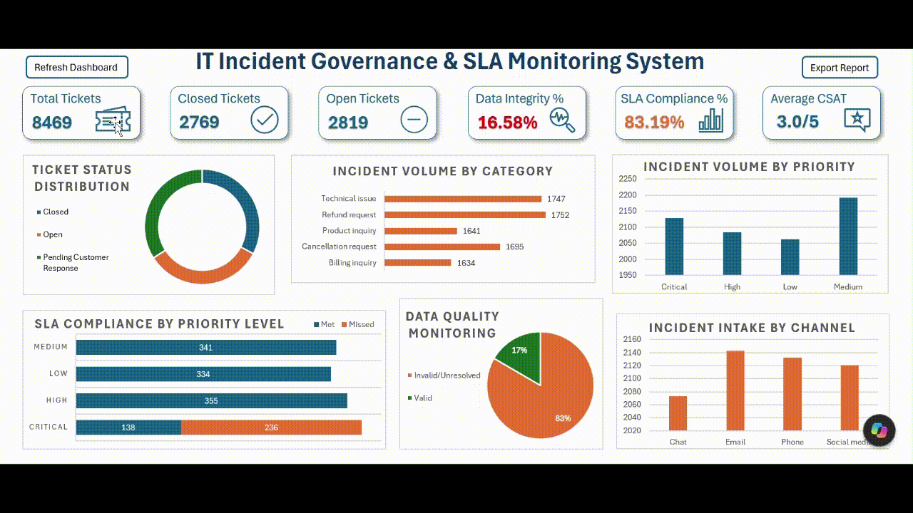
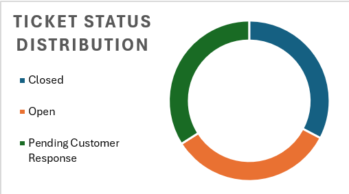
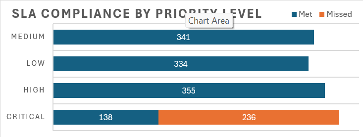
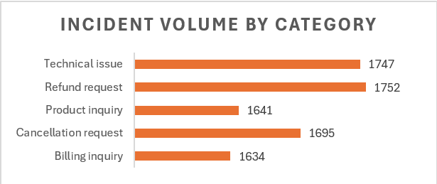
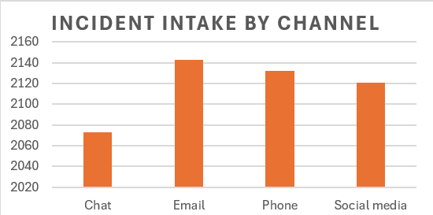
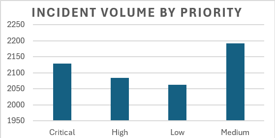
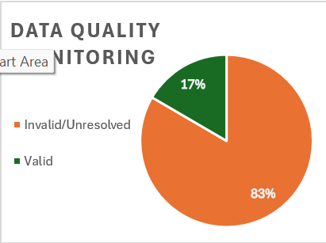

# 🚨 IT Incident Governance & SLA Monitoring System

## 📌 Overview

An end-to-end IT Incident Governance & SLA Monitoring solution built in Microsoft Excel using **Power Query, Pivot Tables, VBA Automation, and Interactive Dashboard Design**.

This project simulates a real-world IT Operations Governance reporting solution used to monitor incident performance, SLA compliance, operational KPIs, data quality, and reporting reliability.

The dashboard was developed to demonstrate competencies relevant to:

- Governance Reporting
- Incident Management
- KPI Monitoring
- SLA Tracking
- Advanced Excel
- VBA Automation

---

## 📷 Dashboard Preview



---

## 🎬 Dashboard Demonstration

A complete walkthrough of dashboard functionality, including VBA automation and PDF report generation.



---

## 🎯 Business Problem

IT Operations teams require accurate reporting mechanisms to:

- Monitor incident volumes and statuses
- Track SLA compliance
- Identify operational bottlenecks
- Measure governance KPIs
- Assess reporting reliability through data quality monitoring
- Automate stakeholder reporting

This project provides a centralized governance dashboard that supports those objectives.

---

## 🛠️ Tech Stack

### Microsoft Excel
- Pivot Tables
- Pivot Charts
- KPI Cards
- Dashboard Design
- Conditional Formatting

### Power Query
- Data Cleaning
- Data Transformation
- Data Validation
- Custom Column Creation

### VBA
- Dashboard Refresh Automation
- Automated PDF Report Generation

---

## 📊 Dashboard KPIs

| KPI | Description |
|------|-------------|
| Total Tickets | Total incidents logged |
| Closed Tickets | Successfully resolved incidents |
| Open Tickets | Incidents pending resolution |
| Data Integrity % | Percentage of records suitable for analysis |
| SLA Compliance % | Percentage of measurable records meeting SLA requirements |
| Average CSAT | Average Customer Satisfaction Score |

---

## 📈 Dashboard Analytics

### 1. Incident Status Distribution

Tracks:

- Closed Tickets
- Open Tickets
- Pending Customer Response



---

### 2. SLA Compliance by Priority Level

Measures SLA performance across:

- Critical
- High
- Medium
- Low



---

### 3. Incident Volume by Category

Analyzes support demand across:

- Technical Issues
- Billing Inquiries
- Product Inquiries
- Refund Requests
- Cancellation Requests



---

### 4. Incident Intake by Channel

Analyzes incident sources across:

- Email
- Phone
- Chat
- Social Media



---

### 5. Incident Volume by Priority

Provides visibility into workload distribution based on priority levels.



---

### 6. Data Integrity Assessment

Evaluates source data reliability and SLA measurability.



---

## 🧹 Data Cleaning & Transformation

Data preparation was performed using Power Query.

### Validation Rules Implemented

- Missing value identification
- Timestamp validation
- Resolution sequence verification
- SLA measurability checks
- Data quality assessment

### Custom Fields Created

- Row Validity
- Resolution Hours
- SLA Threshold Hours
- SLA Met
- SLA Status

---

## ⚠️ Data Quality Findings

During exploratory data analysis, several data quality issues were identified:

- Missing resolution timestamps
- Missing customer satisfaction records
- Inconsistent response timestamps
- Resolution timestamps occurring before response timestamps

### Governance Response

To ensure reporting reliability:

- Invalid records were excluded from SLA calculations
- Data Integrity % was introduced as a governance KPI
- SLA calculations were restricted to measurable records only

---

## ⚡ VBA Automation

### 🔄 Refresh Dashboard

Automates:

- Power Query Refresh
- Pivot Table Refresh
- Dashboard Update

### 📄 Export Dashboard Report

Exports the dashboard to PDF format for governance and stakeholder reporting.

---

## 📊 Key Insights

### SLA Performance

- Critical incidents demonstrated the highest SLA breach rates.
- SLA performance varied significantly across priority levels.

### Incident Trends

- Support demand was distributed across multiple intake channels.
- Certain ticket categories generated higher operational workloads.

### Governance Findings

- Data quality issues significantly impacted SLA measurability.
- Reliable operational reporting depends on continuous data-quality monitoring.

---

## 💼 Skills Demonstrated

### Advanced Excel

- Pivot Tables
- Pivot Charts
- Interactive Dashboards
- KPI Engineering

### Power Query

- ETL Processes
- Data Transformation
- Data Validation
- Data Cleansing

### VBA

- Dashboard Refresh Automation
- Automated PDF Reporting

### Governance & Reporting

- SLA Monitoring
- KPI Tracking
- Data Quality Monitoring
- Operational Reporting

### Business Analysis

- Incident Analytics
- Compliance Monitoring
- Performance Measurement
- Governance Reporting

---

## 🎯 Alignment with Governance & Reporting Roles

This project demonstrates practical skills commonly required in:

- Governance Reporting
- Service Management
- Incident Management
- MIS Reporting
- SLA Monitoring
- Operations Analytics

### Demonstrated Capabilities

✅ SLA/KPI Monitoring

✅ Governance Reporting

✅ Incident Management Analytics

✅ Data Quality Monitoring

✅ Dashboard Development

✅ Power Query ETL

✅ VBA Automation

✅ Stakeholder Reporting

✅ Operational Analytics

---

## 🚀 Future Enhancements

Potential future developments include:

- Automated SLA Breach Reporting
- Email Report Distribution
- Trend Forecasting
- Power BI Migration
- Automated Data Quality Alerts

---

## 📂 Repository Structure

```text
IT-Incident-Governance-SLA-Monitoring-System/
│
├── README.md
├── IT_Incident_Governance_Dashboard.xlsm
│
├── images/
│   ├── dashboard-overview.png
│   ├── dashboard-demo.gif
│   ├── sla-compliance-priority.png
│   ├── incident-status-distribution.png
│   ├── incident-volume-category.png
│   ├── incident-volume-priority.png
│   ├── incident-intake-channel.png
│   └── data-integrity-assessment.png
│
└── reports/
    └── sample-dashboard-report.pdf
